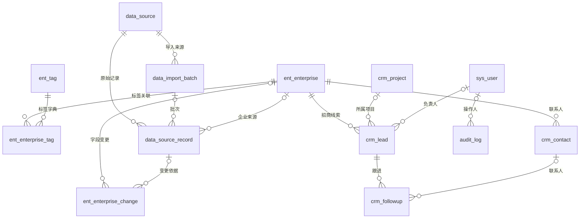

# 全国企业资源与招商管理平台

企业档案通过统一社会信用代码去重。招商项目、线索和跟进记录独立保存，一家企业可以关联多个项目。企业录入、Excel 导入和企业字段更新会记录来源或变更历史，关键写操作写入审计日志。

## 工程与表关系

后端使用 Spring Boot 3.3.5 和 JDK 17，业务数据访问使用 MyBatis（XML Mapper），事务覆盖来源、变更和审计写入。前端使用 Vue 3、TypeScript、Vue Router、Vite 和 Element Plus，登录态和菜单权限在路由守卫中校验。

| 目录或文件 | 内容 |
| --- | --- |
| `sql/` | MySQL 脚本：`enterprise_db.sql` 全量建库；`seed_*` 演示数据；`create-role-users.sql` 角色账号 |
| `backend/src/main/java/com/enterprise/investment/business` | CRM 业务模块：企业档案、导入、项目、线索、商机、合同、回款及跟进接口 |
| `backend/src/main/java/com/enterprise/investment/bidradar` | 标讯雷达模块：标讯查询代理及标讯转线索/商机 |
| `backend/src/main/java/com/enterprise/investment/openclaw` | OpenClaw 模块：网关状态检查与对话代理 |
| `backend/src/main/java/com/enterprise/investment/collector` | 采集器接入（X-Collector-Token）及只读控制台接口 |
| `backend/src/main/java/com/enterprise/investment/mapper` | 各业务模块的 MyBatis Mapper 接口 |
| `backend/src/main/resources/mapper` | MyBatis SQL 映射文件 |
| `backend/src/main/java/com/enterprise/investment/security` | Token 登录、RBAC 权限、数据范围、角色配置及账号创建 |
| `frontend/src` | 管理后台界面 |
| `docker-compose.yml` | MySQL、PostgreSQL、Redis、RabbitMQ、可选 MinIO 及招商应用服务 |



## 本地启动

需要 JDK 17、Maven 3.9、Node.js 22 和 MySQL。可通过 Docker Compose 启动 MySQL，也可使用已运行的本机 MySQL。以下命令在项目根目录运行，适用于 PowerShell 7。

### 容器启动招商工作台

全新数据库可使用以下方式启动（首次构建需要访问镜像仓库、Maven Central、npm 和 PyPI）。初始化管理员密码只用于首次建库；DeepSeek Key 未配置时登录和业务数据页面仍可用，但模型对话不可用。

```powershell
$env:APP_ADMIN_PASSWORD = Read-Host '设置管理员密码（至少 12 个字符）' -MaskInput
$env:DEEPSEEK_API_KEY = Read-Host 'DeepSeek API Key（可留空）' -MaskInput
# 首次生成并安全保存；每次启动使用同一密钥，轮换密钥会使旧 JWT 失效
$env:APP_JWT_SECRET = [Convert]::ToBase64String([Security.Cryptography.RandomNumberGenerator]::GetBytes(32))
# 3306 已被占用时可设置，当前测试环境使用 13307
$env:MYSQL_PORT = '13307'
docker compose --profile app up -d --build --wait
```

打开 `http://127.0.0.1:8088`，默认管理员用户名为 `admin`。容器中的 Agent 使用 PostgreSQL checkpoint，业务数据仍通过 Spring Boot 访问 MySQL。`MYSQL_PORT`、`APP_WEB_PORT` 等可以按需调整；Compose 的示例口令只用于本机开发。自定义 `AGENT_POSTGRES_PASSWORD` 时 Agent 会自动使用同一密码构造连接，特殊字符会编码。

新 MySQL 数据卷会执行 `sql/enterprise_db.sql`，它是包含 Agent、采集、事件流水线结构与菜单的全量 schema；**已有数据卷不会自动重新执行**。默认楼宇的 100～300㎡ 是招商目标，实际可租面积、地址、租金及配套仍为未知。旧数据不会被自动迁入新建数据库。

对象存储目前不参与 Agent 主流程，单独使用 `docker compose --profile storage up -d minio` 启动。MinIO 社区版目前为[源码分发](https://github.com/minio/minio)，官方镜像仓库可用性可能变化；可通过 `MINIO_IMAGE` 指定自行构建并验证的镜像。Compose 内置的存储密码仅供本机开发。

配置 `APP_JWT_SECRET` 后，新登录使用签名 JWT，服务端仍检查数据库中的令牌有效期和撤销状态；已签发的旧随机令牌在原有效期内继续可用。为兼容现有部署，未配置密钥时继续签发旧随机令牌；正式使用 JWT 时请配置并安全保存至少 32 字节随机密钥的 Base64 值。

业务接口保留现有 `/api/enterprises`、`/api/projects` 路径，同时提供 `/api/companies`、`/api/buildings` 别名；两组路径访问同一套企业和项目数据。可在受控环境设置 `APP_OPENAPI_ENABLED=true` 后访问 `/api/swagger-ui.html` 或 `/api/openapi`，接口文档默认关闭，开启后文档本身可访问，业务接口仍需认证。前后端同源部署无需额外跨域配置；确需跨域时，可用 `APP_CORS_ALLOWED_ORIGINS` 配置逗号分隔的明确 `http(s)` 来源，默认不允许跨域，不接受通配符。

部署和功能仍有未完成事项：58 正式接口、真实工商核验联调和完整生产部署尚未完成。已按企查查 2001 接口实现主体核验，但正式调用需要单独开通并可能计费，默认不会自动调用；操作方式见[采集器说明](collector/README.md)。监测进程与事件消费者需要显式启动并配置授权；多轮对话目前最多带入最近四轮报告。完整招商流程已使用隔离测试数据和模拟模型贯通，真实模型及数据源仍需相应凭证联调。详细运行方式、测试结果与缺口见 [招商 Agent 重构计划](docs/招商Agent重构计划.md) 和 [Agent 说明](agent/README.md)。

1. 使用 Docker 时，先打开 Docker Desktop，等 `docker info` 能显示服务端信息，再启动 MySQL。首次创建数据卷时会执行 `sql/enterprise_db.sql`。

   ```powershell
   docker compose up -d --wait mysql
   ```

   `docker compose up -d` 启动无 profile 的基础服务：MySQL、PostgreSQL、Redis 和 RabbitMQ；MinIO 需显式启用 `storage` profile。

   使用本机 MySQL 时，先用数据库管理账号执行 `sql/enterprise_db.sql`，再配置后端的 `DB_URL`、`MYSQL_USER` 和 `MYSQL_PASSWORD`。应用账号需要访问 `enterprise_db` 下的表。

   旧版本数据卷缺少新增表或列时，请先备份，再从 Git 历史获取对应版本的升级脚本按顺序补齐。

2. 打开一个终端，设置首次启动的管理员密码并运行后端。

   ```powershell
   $env:APP_ADMIN_USERNAME = 'admin'
   $env:APP_ADMIN_PASSWORD = Read-Host '设置管理员密码（至少 12 个字符，最多 72 个 UTF-8 字节）' -MaskInput
   $contactKey = Get-Content -LiteralPath .\.env.contact-key | ConvertTo-SecureString
   $env:APP_CONTACT_ENCRYPTION_KEY = [System.Net.NetworkCredential]::new('', $contactKey).Password
   # 可选，登录 Token 有效期，默认 12 小时
   $env:APP_TOKEN_TTL_HOURS = '12'
   mvn -f .\backend\pom.xml spring-boot:run
   ```

   已有启用的管理员时，重启会使用数据库里的账号。修改环境变量不会改写已存密码。默认健康检查地址为 `http://127.0.0.1:8080/api/health`。首次创建联系人密钥的方法见下文。

3. 打开另一个终端，安装前端依赖并启动管理后台。

   ```powershell
   Set-Location .\frontend
   npm.cmd ci --registry https://registry.npmjs.org
   npm.cmd run build
   npm.cmd run preview -- --port 5173 --strictPort
   ```

   打开终端显示的地址，使用管理员账号登录。前端同时监听本机和局域网地址，局域网设备可使用 `http://本机局域网IP:5173/` 访问。Vite 会把 `/api` 请求转发到本地后端。

   Windows 上，当前项目目录名包含 `~`，Vite 的开发服务器会对页面返回 403。上述本地预览方式适用于当前目录。使用热更新开发时，把项目放到不含 `~` 的路径，再运行 `npm.cmd run dev`。

如果主机的 3306 端口已被使用，可在启动 Compose 的终端设置 `$env:MYSQL_PORT = '3307'`，并在后端终端设置 `$env:DB_URL = 'jdbc:mysql://127.0.0.1:3307/enterprise_db?characterEncoding=UTF-8'`。Compose 和后端的 `MYSQL_USER`、`MYSQL_PASSWORD` 必须一致。Compose 中的默认数据库及中间件口令用于本机开发。

如果 8080 已被其他程序占用，在启动前端和后端的两个终端中都先执行 `$env:SERVER_PORT = '8081'`。这样后端监听 8081，Vite 也会把 `/api` 转发到 8081。可用 `http://127.0.0.1:5173/api/health` 同时检查前端代理和后端。

## 角色和数据范围

| 角色 | 可操作的数据 |
| --- | --- |
| 管理员 | 企业、导入、全部项目/线索/商机/合同/回款、跟进，以及账号和角色配置 |
| 数据专员 | 企业档案、企业标签与 Excel 导入，查看企业总数；不参与销售流程 |
| 招商经理 | 浏览企业、管理项目，管理全部线索、商机、合同、回款和联系人 |
| 招商人员 | 浏览企业和项目，管理本人线索和商机，查看本人合同/回款，维护本人线索所属企业的联系人 |

当前按一家企业内部团队配置，每个账号有一个角色。删除企业或项目时，已有线索引用会阻止删除。联系人被跟进记录引用后不能删除。企业详情可查看标签和字段变更，数据管理页可查看导入批次及逐行结果，操作审计保存在数据库中。招商 Agent 的采集与匹配能力和限制见重构计划。

### 认证与权限

登录使用 Bearer Token，原始 Token 只在登录响应中返回，数据库仅保存 SHA-256 哈希，默认 12 小时有效。登出、修改密码、重置密码、停用账号和调整角色都会撤销对应 Token；前端不再使用 Session 或 CSRF。

角色、菜单权限点和数据范围分别保存在 `sys_role`、`sys_menu`、`sys_role_menu`、`sys_user_role`、`sys_role_data_scope`。管理员可在左侧「角色权限」页面配置其他角色的功能权限和数据范围；`ADMIN` 为内置保护角色，权限不可修改，避免管理员锁死自己。数据范围支持：

- `ALL`：全部数据
- `SELF`：仅本人负责的数据
- `OWN_LEADS`：本人负责线索关联企业的联系人（仅联系人资源）

`INVESTMENT_OFFICER` 默认“项目全部、线索本人、联系人本人线索企业”，与升级前行为一致。权限在每次请求时从数据库加载，角色权限修改后不需要重启后端；前端导航会在页面重新加载后刷新。

员工可以通过右上角修改自己的密码。管理员可以重置其他账号密码、调整角色，或停用、启用其他账号。密码重置、角色调整和账号停用会使对方的已有登录 Token 在下一次请求时失效。

工作台显示企业、项目和线索数量，以及逾期、今日剩余和未来七天的跟进提醒。招商人员只看到本人负责的线索统计。记录跟进时，可以设置新的跟进时间，或清除已有提醒。页面每分钟刷新，提醒显示在系统内。

「数据采集」模块下的「采集器」页面展示采集记录和企业信号，并支持配置按企业执行的招聘监测任务；查看需要 `governance:view`，创建和修改任务还需 `monitor:manage`。新任务默认暂停，采集进程须另外启动，具体命令见 [采集器说明](collector/README.md)。

智能招商统一使用「招商Agent」，详见 [招商 Agent 重构计划](docs/招商Agent重构计划.md)。

## CRM 商机、合同与回款

CRM 采用“客户 + 项目资源 + 线索 + 商机”的模型：

- **客户**：企业档案，保留统一社会信用代码、地区、行业等字段。
- **招商项目**：供给侧的招商资源，可以同时关联多家企业，不归属单一客户。
- **线索**：企业与招商项目的初步匹配，保留原有阶段、负责人和跟进。
- **商机**：在线索基础上新增的独立销售机会，关联客户、项目和来源线索，记录阶段、预计金额、概率和负责人。
- **合同/回款**：签约合同挂在客户和商机上；合同标记为“已签约”时自动把商机改为“赢单”；回款按合同登记计划和实收。

页面入口为左侧“商机”“合同”“回款”“业绩统计”。企业详情顶部展示“客户 360”，聚合联系人数、线索、商机、合同和回款。CRM 权限点为 `business:*`、`contract:*`、`receivable:*`、`statistics:view`，数据范围支持 `ALL` 和 `SELF`，管理员可在角色权限页配置。

## 标讯雷达

平台左侧「标讯雷达」接入独立的 BidRadar 服务，用于按主题搜索招标公告、定向采集官方栏目页、查看采购意向和关注采购人，并把公告转为 CRM 线索或商机。

先启动 BidRadar（它仍只监听 `127.0.0.1:8765`，不直接暴露局域网）：

```powershell
cd D:\公司\bidradar-deepseek\bidradar
py -3 app.py
```

平台后端通过 `app.bid-radar.base-url`（环境变量 `BIDRADAR_BASE_URL`，默认 `http://127.0.0.1:8765`）代理它的 API，并用平台的 `bidradar:view` 权限保护。管理员、招商经理和招商专员默认有访问权限，可在角色权限页调整。

第一期包含：

- 关注主题的新建、编辑、删除，DeepSeek 搜索和站点采集；
- 公告列表、详情、原始链接、正文获取、收藏、核验与跟进备注；
- 采购意向筛选与意向搜索；
- 关注采购人及按采购人查看公告；
- 公告转线索/商机：选择客户和招商项目，线索会带来源 URL，可用截止时间生成下次跟进提醒；同一 URL 不能重复转换。

暂未接入自动工作流和 CSV 导出，仍可在 BidRadar 自己的界面使用。DeepSeek 密钥保存在 BidRadar 的 `.env`，不要提交到仓库。

### 企查查招投标查询

标讯雷达支持按关注主题手动查询企查查开放平台的「招投标信息」ApiCode 958。企业实名认证、接口开通和应用场景审核以企查查要求为准。查询按钮只对平台管理员显示；BidRadar 单机页面也可查询。

在 `bidradar/.env` 中追加以下配置（不要覆盖已有的 DeepSeek 配置，也不要将 `.env` 提交到仓库），然后重新启动 BidRadar：

```dotenv
QCC_APP_KEY=企查查AppKey
QCC_SECRET_KEY=企查查SecretKey
```

每次手动点击查询只请求一页，每页最多 20 条；不会自动翻页、重试或加入定时工作流。查询可能消耗接口额度，请以企查查当前规则为准。平台页面可按省市名称和信息类型筛选；独立页面支持关键词和信息类型。仅保留符合主题规则且有原文链接的记录，按链接去重。企查查提供的预算、采购人及投标截止时间单独标为待核实，不覆盖人工跟进。缺少原文链接和未匹配主题的数量会在查询后显示。

### OpenClaw 助手

平台管理员可以从左侧进入 OpenClaw 助手。后端仅连接本机 `127.0.0.1:18789`，网关令牌留在服务端；每次新建对话使用独立会话。对话使用独立的 `crm-chat` 智能体，配置只允许 `session_status` 工具并禁止 `gateway`，不使用已有主智能体的操作权限。

「写字楼获客助手」默认以南京鼓楼区示范写字楼为项目，行业不限。管理员点击「让龙虾寻找南京企业线索」后，后端进行最多 3 次南京公开网页搜索，并把搜索摘录和项目条件交给受限的 OpenClaw 智能体分析。搜索由用户手动发起，没有后台定时任务或自动重试；搜索和模型调用可能产生费用，计费规则见 [DeepSeek 搜索说明](https://api-docs.deepseek.com/guides/search/)。企查查接口不必开通即可使用此搜索。

搜索使用环境变量 `DEEPSEEK_API_KEY`，未设置时读取项目内 `bidradar/.env` 的同名配置；其他部署路径可通过 `app.prospecting.key-file` 指定文件。密钥只在服务端使用。系统从公告明确的采购人等字段提取候选，也验证 AI 返回的企业名称及证据片段是否出现在对应的搜索摘录里，并展示原文链接；这不能代替人工核验企业角色、公告日期和需求现状，已成交、续租或出租方不一定是当前客户。若 AI 未能提取有效线索，仍可查看来源字段识别出的候选和本轮搜索来源。结果保留在当前对话中，刷新页面后不会自动保存。

用户也可以手动查询企业资源库或填写尚未入库的企业，补充公开线索后生成分析内容；生成只填入对话框，用户检查并点击发送后才交给 OpenClaw。系统不会自动读取整个企业库、创建 CRM 线索或联系企业。名称标有「示例」「虚构」的企业不能视为真实客户；注册地不等于实际办公地点。

OpenClaw 的 HTTP 对话接口默认关闭。当前 Linux 实例已配置以下受限助手和对话接口。其他实例可在其配置界面把对应字段**合并**到已有配置，不要覆盖整个配置或删除原有智能体：

```json
{
  "gateway": { "http": { "endpoints": { "chatCompletions": { "enabled": true } } } },
  "agents": { "entries": { "crm-chat": {
    "workspace": "~/.openclaw-xiaobei/workspace-crm-chat",
    "skills": [],
    "tools": {
      "profile": "minimal",
      "allow": ["session_status"],
      "deny": ["gateway"],
      "elevated": { "enabled": false }
    }
  } } }
}
```

当前 Linux 实例通过现有 SSH 转发提供本机 `18789`，转发需要保持运行。网关令牌使用当前 Windows 账号加密保存在项目根目录的 `.env.openclaw-token`，该文件已被 Git 忽略；不要将其提交或分享。后端需由同一 Windows 账号启动，切换账号或机器时需要重新配置令牌。

后端每次连接都会只读核验网关**已生效**的配置和助手权限；配置未生效、权限不符或令牌不可用时，对话保持关闭。其他部署环境可通过 `OPENCLAW_GATEWAY_TOKEN` 提供令牌，或通过 `OPENCLAW_GATEWAY_TOKEN_FILE` 指定同账号加密的令牌文件。智能体继承其默认模型及可用的共享模型凭证；对话内容会由 OpenClaw 和其模型服务处理。

## 联系人加密密钥

联系人电话和邮箱使用 `APP_CONTACT_ENCRYPTION_KEY` 加密。Windows 本机首次安装且尚无加密联系人数据时，可在项目根目录生成密钥文件：

```powershell
if (Test-Path -LiteralPath .\.env.contact-key) { throw '密钥文件已存在，请继续使用原密钥' }
$newKey = [Convert]::ToBase64String([System.Security.Cryptography.RandomNumberGenerator]::GetBytes(32))
ConvertTo-SecureString $newKey -AsPlainText -Force | ConvertFrom-SecureString | Set-Content -LiteralPath .\.env.contact-key
Remove-Variable newKey
```

启动后端前按上面的命令从该文件设置环境变量。文件受当前 Windows 用户保护，并已加入 Git 忽略规则。迁移或备份数据库时，需要同时以安全方式保管原始密钥。已有加密联系人数据时应恢复对应密钥，密钥丢失后无法解密数据。其他运行环境需要通过环境变量提供同一个 Base64 编码的 32 字节密钥。

## Excel 导入

使用 `.xlsx` 文件的第一个工作表，第一行写列名，每行填写一家企业。最小表头为「企业名称」，可添加「统一社会信用代码」「省份」「城市」「区县」「行业代码」「行业名称」「经营状态」等列。省市区可填写名称，例如「江苏省」「南京市」「玄武区」，也兼容原有代码格式。统一社会信用代码列使用文本格式，可避免 Excel 改写代码。单次最多 5 MB、5,000 行。

已存在的统一社会信用代码会在逐行结果中标出，现有档案予以保留。缺少信用代码且可能匹配现有企业时，需要人工确认。导入完成后可查看批次、成功数和逐行错误。

地区选项使用截至 2025 年的县级以上行政区划数据，来源为 [areacodes](https://github.com/yescallop/areacodes) 的 CC0 数据集。省市名称和旧的地区代码均可用于查询。

## 构建

```powershell
mvn -f .\backend\pom.xml package
npm.cmd --prefix .\frontend run build
docker compose config --quiet
```
