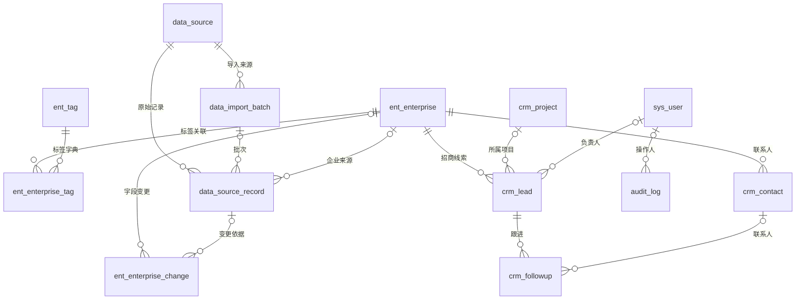

# 全国企业资源与招商管理平台

企业档案通过统一社会信用代码去重。招商项目、线索和跟进记录独立保存，一家企业可以关联多个项目。企业录入、Excel 导入和企业字段更新会记录来源或变更历史，关键写操作写入审计日志。

## 工程与表关系

后端使用 Spring Boot 3.3.5 和 JDK 17，业务数据访问使用 Spring JDBC，事务覆盖来源、变更和审计写入。前端使用 Vue 3、TypeScript、Vite 和 Element Plus。

| 目录或文件 | 内容 |
| --- | --- |
| `enterprise_db.sql` | 企业、招商、数据治理、账号及审计的 MySQL 建表脚本 |
| `backend/src/main/java/com/enterprise/investment/business` | 企业档案、导入、项目、线索及跟进接口 |
| `backend/src/main/java/com/enterprise/investment/security` | 登录、会话校验、角色权限及账号创建 |
| `frontend/src` | 管理后台界面 |
| `docker-compose.yml` | MySQL、Redis、RabbitMQ、MinIO 本地服务 |



## 本地启动

需要 JDK 17、Maven 3.9、Node.js 22 和 Docker Compose。以下命令在项目根目录运行，适用于 PowerShell 7。

1. 启动 MySQL，首次创建数据卷时会执行 `enterprise_db.sql`。

   ```powershell
   docker compose up -d --wait mysql
   ```

   完整的基础服务用 `docker compose up -d` 启动。当前业务使用 MySQL，Compose 同时提供 Redis、RabbitMQ 和 MinIO。

2. 打开一个终端，设置首次启动的管理员密码并运行后端。

   ```powershell
   $env:APP_ADMIN_USERNAME = 'admin'
   $env:APP_ADMIN_PASSWORD = Read-Host '设置管理员密码（至少 12 个字符，最多 72 个 UTF-8 字节）' -MaskInput
   mvn -f .\backend\pom.xml spring-boot:run
   ```

   已有启用的管理员时，重启会使用数据库里的账号。修改环境变量不会改写已存密码。后端健康检查地址为 `http://127.0.0.1:8080/api/health`。

3. 打开另一个终端，安装前端依赖并启动管理后台。

   ```powershell
   Set-Location .\frontend
   npm.cmd ci --registry https://registry.npmjs.org
   npm.cmd run dev
   ```

   打开终端显示的本地地址，使用刚创建的管理员账号登录。Vite 会把 `/api` 请求转发到本地后端。

如果主机的 3306 端口已被使用，可在启动 Compose 的终端设置 `$env:MYSQL_PORT = '3307'`，并在后端终端设置 `$env:DB_URL = 'jdbc:mysql://127.0.0.1:3307/enterprise_db?characterEncoding=UTF-8'`。Compose 和后端的 `MYSQL_USER`、`MYSQL_PASSWORD` 必须一致。Compose 中的默认数据库及中间件口令用于本机开发。

已有独立 MySQL 时，可以用管理账号执行 `enterprise_db.sql`，再配置 `DB_URL`、`MYSQL_USER` 和 `MYSQL_PASSWORD`。应用账号需要访问 `enterprise_db` 下的表。

## 角色和数据范围

| 角色 | 可操作的数据 |
| --- | --- |
| 管理员 | 企业、导入、全部招商项目和线索、跟进、创建员工账号 |
| 数据专员 | 企业档案与 Excel 导入 |
| 招商经理 | 浏览企业、管理项目、分配与跟进全部线索 |
| 招商人员 | 浏览企业和项目，创建归属于自己的线索，更新和跟进指派给自己的线索 |

当前按一家企业内部团队配置，每个账号有一个角色。删除企业或项目时，已有线索引用会阻止删除。企业来源、字段变更及操作审计可在数据库中查询。联系人预留了加密字段，联系人管理、外部采集和 AI 匹配留待后续阶段。

## Excel 导入

使用 `.xlsx` 文件的第一个工作表，第一行写列名，每行填写一家企业。最小表头为「企业名称」，可添加「统一社会信用代码」「省份代码」「城市代码」「行业代码」「行业名称」「经营状态」等列。统一社会信用代码列使用文本格式，可避免 Excel 改写代码。单次最多 5 MB、5,000 行。

已存在的统一社会信用代码会在逐行结果中标出，现有档案予以保留。缺少信用代码且可能匹配现有企业时，需要人工确认。导入完成后可查看批次、成功数和逐行错误。

## 构建

```powershell
mvn -f .\backend\pom.xml package
npm.cmd --prefix .\frontend run build
docker compose config --quiet
```
