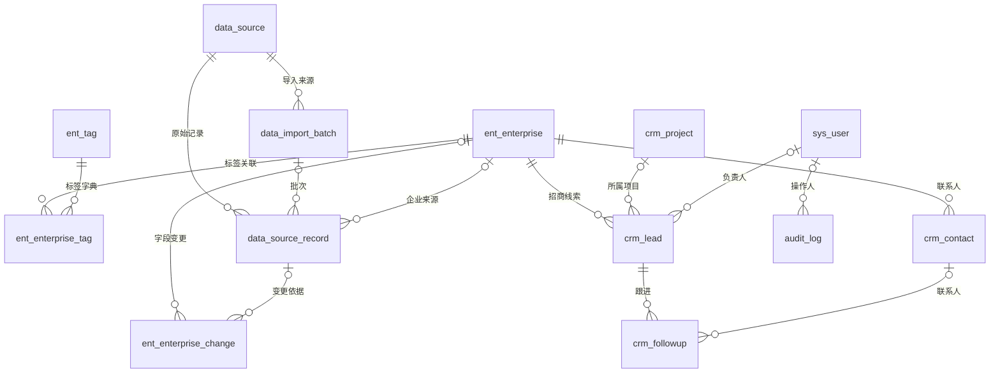

# 全国企业资源与招商管理平台

企业档案通过统一社会信用代码去重。招商项目、线索和跟进记录独立保存，一家企业可以关联多个项目。企业录入、Excel 导入和企业字段更新会记录来源或变更历史，关键写操作写入审计日志。

## 工程与表关系

后端使用 Spring Boot 3.3.5 和 JDK 17，业务数据访问使用 Spring JDBC，事务覆盖来源、变更和审计写入。前端使用 Vue 3、TypeScript、Vite 和 Element Plus。

| 目录或文件 | 内容 |
| --- | --- |
| `enterprise_db.sql` | 企业、招商、数据治理、账号及审计的 MySQL 建表脚本 |
| `backend/src/main/java/com/enterprise/investment/business` | 企业档案、导入、项目、线索及跟进接口 |
| `backend/src/main/java/com/enterprise/investment/security` | 登录、会话校验、角色权限及账号创建 |
| `frontend/src` | 管理后台界面 |
| `docker-compose.yml` | MySQL、Redis、RabbitMQ、MinIO 本地服务 |



## 本地启动

需要 JDK 17、Maven 3.9、Node.js 22 和 MySQL。可通过 Docker Compose 启动 MySQL，也可使用已运行的本机 MySQL。以下命令在项目根目录运行，适用于 PowerShell 7。

1. 使用 Docker 时，先打开 Docker Desktop，等 `docker info` 能显示服务端信息，再启动 MySQL。首次创建数据卷时会执行 `enterprise_db.sql`。

   ```powershell
   docker compose up -d --wait mysql
   ```

   完整的基础服务用 `docker compose up -d` 启动。当前业务使用 MySQL，Compose 同时提供 Redis、RabbitMQ 和 MinIO。

   使用本机 MySQL 时，先用数据库管理账号执行 `enterprise_db.sql`，再配置后端的 `DB_URL`、`MYSQL_USER` 和 `MYSQL_PASSWORD`。应用账号需要访问 `enterprise_db` 下的表。已完成建表时，可直接启动后端。

2. 打开一个终端，设置首次启动的管理员密码并运行后端。

   ```powershell
   $env:APP_ADMIN_USERNAME = 'admin'
   $env:APP_ADMIN_PASSWORD = Read-Host '设置管理员密码（至少 12 个字符，最多 72 个 UTF-8 字节）' -MaskInput
   $contactKey = Get-Content -LiteralPath .\.env.contact-key | ConvertTo-SecureString
   $env:APP_CONTACT_ENCRYPTION_KEY = [System.Net.NetworkCredential]::new('', $contactKey).Password
   mvn -f .\backend\pom.xml spring-boot:run
   ```

   已有启用的管理员时，重启会使用数据库里的账号。修改环境变量不会改写已存密码。默认健康检查地址为 `http://127.0.0.1:8080/api/health`。首次创建联系人密钥的方法见下文。

3. 打开另一个终端，安装前端依赖并启动管理后台。

   ```powershell
   Set-Location .\frontend
   npm.cmd ci --registry https://registry.npmjs.org
   npm.cmd run build
   npm.cmd run preview -- --port 5173 --strictPort
   ```

   打开终端显示的地址，使用管理员账号登录。前端同时监听本机和局域网地址，局域网设备可使用 `http://本机局域网IP:5173/` 访问。Vite 会把 `/api` 请求转发到本地后端。

   Windows 上，当前项目目录名包含 `~`，Vite 的开发服务器会对页面返回 403。上述本地预览方式适用于当前目录。使用热更新开发时，把项目放到不含 `~` 的路径，再运行 `npm.cmd run dev`。

如果主机的 3306 端口已被使用，可在启动 Compose 的终端设置 `$env:MYSQL_PORT = '3307'`，并在后端终端设置 `$env:DB_URL = 'jdbc:mysql://127.0.0.1:3307/enterprise_db?characterEncoding=UTF-8'`。Compose 和后端的 `MYSQL_USER`、`MYSQL_PASSWORD` 必须一致。Compose 中的默认数据库及中间件口令用于本机开发。

如果 8080 已被其他程序占用，在启动前端和后端的两个终端中都先执行 `$env:SERVER_PORT = '8081'`。这样后端监听 8081，Vite 也会把 `/api` 转发到 8081。可用 `http://127.0.0.1:5173/api/health` 同时检查前端代理和后端。

## 角色和数据范围

| 角色 | 可操作的数据 |
| --- | --- |
| 管理员 | 企业、导入、全部招商项目和线索、跟进，以及创建、停用和重置员工账号 |
| 数据专员 | 企业档案、企业标签与 Excel 导入，查看企业总数 |
| 招商经理 | 浏览企业、管理项目、分配与跟进全部线索，管理联系人 |
| 招商人员 | 浏览企业和项目，管理本人线索所属企业的联系人，创建归属于自己的线索，更新和跟进指派给自己的线索 |

当前按一家企业内部团队配置，每个账号有一个角色。删除企业或项目时，已有线索引用会阻止删除。联系人被跟进记录引用后不能删除。企业详情可查看标签和字段变更，数据管理页可查看导入批次及逐行结果，操作审计保存在数据库中。外部采集和 AI 匹配留待后续阶段。

员工可以通过右上角修改自己的密码。管理员可以重置其他账号密码，或停用、启用其他账号。密码重置和账号停用会使对方的已有登录会话在下一次请求时失效。

工作台显示企业、项目和线索数量，以及逾期、今日剩余和未来七天的跟进提醒。招商人员只看到本人负责的线索统计。记录跟进时，可以设置新的跟进时间，或清除已有提醒。页面每分钟刷新，提醒显示在系统内。

## 联系人加密密钥

联系人电话和邮箱使用 `APP_CONTACT_ENCRYPTION_KEY` 加密。Windows 本机首次安装且尚无加密联系人数据时，可在项目根目录生成密钥文件：

```powershell
if (Test-Path -LiteralPath .\.env.contact-key) { throw '密钥文件已存在，请继续使用原密钥' }
$newKey = [Convert]::ToBase64String([System.Security.Cryptography.RandomNumberGenerator]::GetBytes(32))
ConvertTo-SecureString $newKey -AsPlainText -Force | ConvertFrom-SecureString | Set-Content -LiteralPath .\.env.contact-key
Remove-Variable newKey
```

启动后端前按上面的命令从该文件设置环境变量。文件受当前 Windows 用户保护，并已加入 Git 忽略规则。迁移或备份数据库时，需要同时以安全方式保管原始密钥。已有加密联系人数据时应恢复对应密钥，密钥丢失后无法解密数据。其他运行环境需要通过环境变量提供同一个 Base64 编码的 32 字节密钥。

## Excel 导入

使用 `.xlsx` 文件的第一个工作表，第一行写列名，每行填写一家企业。最小表头为「企业名称」，可添加「统一社会信用代码」「省份代码」「城市代码」「行业代码」「行业名称」「经营状态」等列。统一社会信用代码列使用文本格式，可避免 Excel 改写代码。单次最多 5 MB、5,000 行。

已存在的统一社会信用代码会在逐行结果中标出，现有档案予以保留。缺少信用代码且可能匹配现有企业时，需要人工确认。导入完成后可查看批次、成功数和逐行错误。

## 构建

```powershell
mvn -f .\backend\pom.xml package
npm.cmd --prefix .\frontend run build
docker compose config --quiet
```
